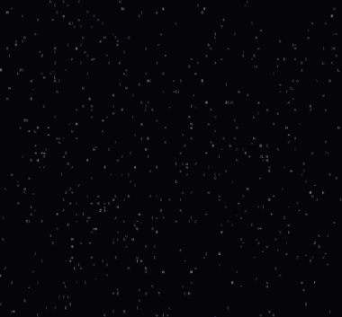
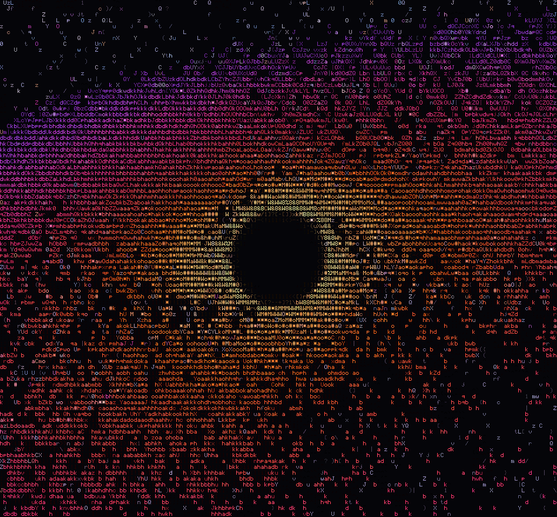

# Blackhole — Procedural ASCII Art Animation (`aGsx`)



Pure-code procedural animated ASCII black hole simulation built with **Python**, **NumPy**, and **Tkinter** (`88×158` character grid, `32,768` 3D particles rendered via a `6×10` NumPy glyph-atlas at `30 FPS`) — **zero video files, images, or external media behind the code**.

Created by **Mahamad (`aGsx` / `@aGsx-bit`)**.

## Preview



## Features

- **100% Pure Procedural 3D Simulation:** `32,768` particles + `1,100` ambient stars projected through an orbiting 3D camera with relativistic gravitational lensing (`Einstein` upper & lower arches), Doppler beaming, and hue-preserving bloom.
- **Multi-Stage Choreography (`~30s` seamless loop):**
  - Sparse 3D drifting ASCII starfield condensing into silky steel-blue cosmic dust bands as the event horizon opens.
  - Orbiting 3D Gargantua accretion disk (`peach-gold → fiery orange → crimson-magenta → royal purple`) with a **beat-synced blackhole-only heartbeat** (`pulse(t)`).
  - High-contrast inward collapse draining into a crisp golden photon ring.
  - Re-explosion into a 4-color neon spiral galaxy (`cyan`, `cobalt blue`, `magenta-purple`, `gold`), inner cavity hollowing, vortex infall, and final photon ring fadeout.
- **Smooth `30 FPS` Glyph-Atlas Engine:** Renders `13,904` colored ASCII cells (`948×880` px) directly to `tk.PhotoImage` using a `5×9` bitmap font across the 70-character Paul Bourke ramp.
- **Interactive Controls:**
  - `R` — Restart animation from `t = 0.0`
  - `Space` — Pause / Resume without losing elapsed time
  - `A` — Jump directly to the final photon ring (`28.00s`)
  - `Esc` — Close window

## Quick Start

```bash
git clone https://github.com/aGsx-bit/blackhole-ascii.git
cd blackhole-ascii
pip install -r requirements.txt
python blackhole.py
```

## License & Mandatory Attribution

Licensed under the [Attribution Open Source License](./LICENSE).  
**Copyright © 2026 Mahamad (`aGsx` / `@aGsx-bit`).**

Anyone using, forking, recording, sharing, or building upon this project **must visibly credit Mahamad (`aGsx` / `@aGsx-bit`)** and preserve the original [LICENSE](./LICENSE) notice.

---
*Keywords: python ascii art, procedural ascii animation, black hole simulation, interstellar gargantua ascii, tkinter ascii animation, numpy 3d particles, creative coding python, generative art, terminal style animation, aGsx*
